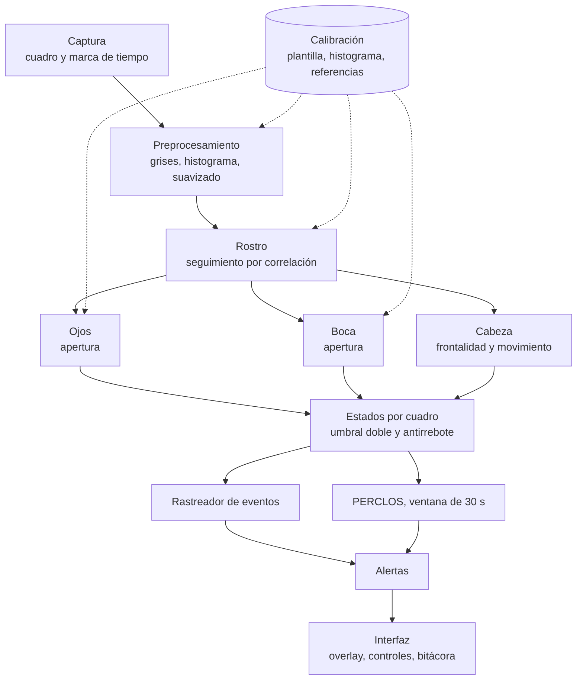

# Detección de somnolencia y distracción

Proyecto final de Visión Computacional y Procesamiento Digital de Imágenes (PCIC-UNAM, semestre 2027-1).

El sistema analiza en tiempo real el video de una persona frente a una cámara. Detecta parpadeos y los clasifica por duración, cuenta bostezos, mide cuánto tiempo pasa la persona sin mirar al frente y calcula la métrica PERCLOS. Todo se muestra superpuesto sobre el video, con alertas.

Está construido con algoritmos clásicos de visión computacional implementados por el equipo. No usa redes neuronales ni modelos preentrenados.

| | |
|---|---|
| **Estado** | Planeación. Todavía no hay código. El repositorio contiene el diseño completo y las instrucciones para construirlo |
| **Lenguaje** | Python 3.10 o más reciente |
| **Bibliotecas del sistema** | NumPy y OpenCV (de OpenCV solo lectura de video, conversión a grises y ventanas) |
| **Meta interna** | Todo funcionando el 2 de diciembre de 2026 |
| **Entrega** | Sin fecha oficial todavía. Se espera en los primeros 10 días de diciembre |

Este es un proyecto académico. No es un dispositivo de seguridad y no debe usarse para conducir.

---

## Qué hace

El sistema observa tres señales del rostro y aplica las reglas del enunciado del proyecto.

### Parpadeos

Cada cierre de ojos se mide y se clasifica al terminar.

| Categoría | Duración del cierre |
|---|---|
| Parpadeo normal | t ≤ 0.5 s |
| Parpadeo lento | 0.5 s < t ≤ 7 s |
| Microsueño | t > 7 s |

### Bostezos

Se cuentan como eventos independientes. Un bostezo es la boca abierta de forma sostenida. La duración mínima es de 1.5 s, provisional (decisión D11).

### Distracción

Un episodio de distracción es el tiempo que la cabeza deja de estar de frente. Al terminar se asigna a una banda.

| Banda | Duración del episodio |
|---|---|
| No se cuenta | menos de 0.5 s |
| 0.5 | de 0.5 a menos de 1.0 s |
| 1.0 | de 1.0 a menos de 1.5 s |
| 1.5 | de 1.5 a menos de 2.0 s |
| 2.0 | 2.0 s o más |

Esta lectura de las bandas está por confirmarse con los profesores (decisión D10).

### PERCLOS

Porcentaje del tiempo con los ojos cerrados en los últimos 30 segundos.

| Nivel | PERCLOS |
|---|---|
| Normal | menos de 8% |
| Alerta | de 8% a menos de 15% |
| Fatiga | de 15% a menos de 30% |
| Somnolencia | 30% o más |

Falta confirmar con los profesores si los parpadeos normales cuentan para PERCLOS (decisión D09). Mientras tanto no cuentan, y se puede cambiar con un interruptor.

### Alertas

La alerta se dispara mientras el evento sigue en curso, no cuando termina. Se muestra la más grave que se cumpla.

| Nivel | Condición |
|---|---|
| Crítica | Cierre en curso de más de 7 s, o PERCLOS en somnolencia |
| Alerta | Cierre en curso de 1.5 s o más, o PERCLOS en fatiga, o distracción en curso de 2.0 s o más |
| Aviso | PERCLOS en alerta, o distracción en curso de 1.0 s o más |

El aviso a los 1.5 s de cierre sale del umbral de alerta de la referencia [1] del enunciado.

---

## Cómo funciona

El sistema tiene dos capas que no se mezclan.

La capa de **percepción** recibe un cuadro de video y entrega tres números entre 0 y 1: qué tan abiertos están los ojos, qué tan abierta está la boca y qué tan de frente está la cabeza. Aquí viven todos los algoritmos de visión computacional.

La capa **temporal** no ve imágenes. Recibe esos tres números con su marca de tiempo y decide qué está pasando: qué eventos hay, cuánto duran, cuánto vale PERCLOS y qué alerta toca.



### Lo que le pasa a un cuadro

1. Llega un cuadro con su marca de tiempo. Se pasa a grises y se lleva a 640×360.
2. Se construye una pirámide gaussiana de tres niveles (640×360, 320×180, 160×90).
3. En el nivel más pequeño se busca la plantilla del rostro guardada en la calibración, solo cerca de donde estaba en el cuadro anterior. La posición se afina en el nivel siguiente. Sale una caja y un puntaje de parecido.
4. El rostro se recorta y se lleva a un tamaño fijo de 128×160. Su histograma se ajusta al del cuadro de calibración.
5. En la franja de los ojos se calcula el gradiente vertical y se mide la separación entre los bordes de los párpados. Comparada con la calibración, da la apertura.
6. Lo mismo en la franja de la boca.
7. El puntaje de parecido dice qué tan de frente está la cabeza. La correlación de fase contra el cuadro anterior dice hacia dónde se movió.
8. Las tres mediciones se convierten en estados (abierto o cerrado, atento o distraído).
9. Se actualizan los eventos, PERCLOS y la alerta.
10. Se dibuja todo sobre el cuadro.

Si en el paso 3 el rostro no se parece a la plantilla, la persona volteó. Ojos y boca se marcan como "sin dato" en lugar de inventar una medición, y la cabeza pasa a distraída.

### Calibración

Al iniciar, la persona coloca la cara en un recuadro. Mira al frente 3 s con los ojos abiertos y después cierra los ojos 2 s. Con eso el sistema guarda la plantilla del rostro, el histograma de referencia, dónde están los ojos y cuánto se separan los párpados abiertos y cerrados.

Así todos los umbrales son relativos a la persona y a la luz del momento. La limitación es que el sistema queda calibrado para una persona por sesión.

---

## Algoritmos implementados por el equipo

El enunciado pide al menos cuatro algoritmos vistos en clase. Hay seis, todos tomados de las prácticas del curso.

| # | Algoritmo | Práctica | Para qué se usa | Archivo | Se verifica contra |
|---|---|---|---|---|---|
| 1 | Especificación de histograma | P4 | Igualar la iluminación de cada cuadro a la de la calibración | `preproceso.py` | Histograma acumulado objetivo |
| 2 | Filtros espaciales (binomial y gradiente) | P5 | Quitar ruido y medir la separación de párpados y labios | `preproceso.py`, `gradiente.py` | `cv2.GaussianBlur`, `cv2.Sobel` |
| 3 | Pirámide gaussiana y banda laplaciana | P6 | Buscar el rostro de grueso a fino | `piramide.py` | `cv2.pyrDown` |
| 4 | Correlación de fase (Fourier) | P6 | Medir el desplazamiento de la cabeza entre cuadros | `correlacion.py` | `cv2.phaseCorrelate` |
| 5 | Transformación geométrica con mapeo inverso | P3 | Llevar el rostro a un tamaño fijo | `geometria.py` | `cv2.warpAffine` |
| 6 | Correlación normalizada | P5 | Seguir el rostro y medir qué tan de frente está | `correlacion.py` | `cv2.matchTemplate` |

Las funciones de OpenCV de la última columna solo se usan para comprobar que la versión propia da lo mismo. Nunca aparecen dentro del sistema, y una prueba automática lo vigila.

---

## Estructura del repositorio

Cada carpeta tiene un `README.md` que dice qué código va ahí, qué recibe, qué entrega y cuándo se considera terminado. Los archivos `.py` de abajo todavía no existen. Son los que hay que escribir.

```
somnolencia-vision/
├── README.md                      este archivo
├── .gitignore                     impide subir videos e imágenes con rostros
├── requirements.txt               numpy y opencv-python (por crear)
├── requirements-dev.txt           pytest, matplotlib, jupyter (por crear)
│
├── docs/                          documentación del proyecto
│   ├── arquitectura.md            las dos capas, los contratos entre módulos
│   ├── plan_de_trabajo.md         pasos en orden, con fechas y responsables
│   ├── decisiones.md              qué se decidió, qué falta y por qué
│   ├── datos_y_gobernanza.md      qué datos hay y cómo se cuidan
│   ├── algoritmos_y_modelos.md    algoritmos propios y ficha del sistema
│   ├── evaluacion.md              cómo se mide que funciona
│   ├── despliegue_y_demo.md       instalación, versiones, ensayo de la demo
│   ├── flujo_git.md               cómo trabajar con Git
│   └── guia_de_supervision.md     para quien coordina al equipo
│
├── somnolencia/                   el sistema, lo único que corre en la demo
│   ├── config.py                  todos los umbrales y parámetros, con su fuente
│   ├── tipos.py                   estructuras que comparten los módulos
│   ├── simulador.py               mediciones inventadas, para probar sin cámara
│   ├── principal.py               ciclo principal
│   ├── percepcion/                de un cuadro a tres mediciones
│   │   ├── captura.py             cámara o video, con marca de tiempo
│   │   ├── calibracion.py         referencias de la persona
│   │   ├── preproceso.py          grises, suavizado, histograma
│   │   ├── piramide.py            pirámide gaussiana y banda laplaciana
│   │   ├── correlacion.py         correlación normalizada y de fase
│   │   ├── geometria.py           recorte y escalado con mapeo inverso
│   │   ├── gradiente.py           gradiente vertical y separación de bordes
│   │   ├── rostro.py              seguimiento del rostro
│   │   ├── ojos.py                apertura de ojos
│   │   ├── boca.py                apertura de boca
│   │   └── cabeza.py              frontalidad y movimiento
│   ├── temporal/                  de mediciones a eventos y alertas
│   │   ├── estados.py             umbral doble y antirrebote
│   │   ├── eventos.py             parpadeos, bostezos, distracción
│   │   ├── perclos.py             ventana deslizante de 30 s
│   │   └── alertas.py             qué alerta mostrar
│   └── interfaz/                  lo que se ve y lo que se guarda
│       ├── overlay.py             dibujo sobre el video y vista de depuración
│       ├── controles.py           deslizadores y teclas
│       └── bitacora.py            eventos a CSV
│
├── verificacion/                  un cuaderno por algoritmo, contra OpenCV
├── evaluacion/                    métricas por cuadro, por evento y de desempeño
├── pruebas/                       pruebas automáticas
├── datos/                         datos locales (casi nada se sube)
│   ├── manifiesto.csv             una fila por video
│   └── anotaciones/               inicio y fin de cada evento real
└── reporte/                       estructura del reporte y guion del video
```

---

## Instalación y ejecución

```bash
git clone <URL del repositorio>
cd somnolencia-vision
python -m venv .venv
source .venv/bin/activate          # en Windows: .venv\Scripts\activate
pip install -r requirements.txt
```

Para comprobar que la cámara abre:

```bash
python -c "import cv2; c = cv2.VideoCapture(0); print('camara:', c.isOpened()); c.release()"
```

Para correr el sistema:

```bash
python -m somnolencia.principal --fuente 0                     # cámara
python -m somnolencia.principal --fuente datos/videos/P01_G2_01.mp4   # archivo de video
python -m somnolencia.principal --fuente simulador             # señales inventadas, sin cámara
```

Teclas dentro de la ventana:

| Tecla | Acción |
|---|---|
| `c` | Recalibrar |
| `d` | Mostrar u ocultar la vista de depuración |
| `r` | Reiniciar contadores |
| `q` | Salir |

Para correr las pruebas:

```bash
pip install -r requirements-dev.txt
pytest
```

El detalle, la solución de problemas y la lista del día de la demo están en [docs/despliegue_y_demo.md](docs/despliegue_y_demo.md).

---

## Cómo se trabaja

### Frentes

El trabajo se reparte en cuatro frentes, uno por integrante.

| Frente | Qué incluye |
|---|---|
| 1. Rostro | Captura, calibración, pirámide, correlación normalizada, seguimiento, normalización geométrica |
| 2. Ojos | Especificación de histograma, suavizado, gradiente, apertura de ojos |
| 3. Boca y cabeza | Apertura de boca, correlación de fase, señal de distracción |
| 4. Temporal y evaluación | Estados, eventos, PERCLOS, alertas, interfaz, ciclo principal, anotación y métricas |

Cada frente escribe también su sección del reporte.

### Acuerdo entre módulos

Los tres módulos de medición (`ojos.py`, `boca.py`, `cabeza.py`) entregan lo mismo: un valor entre 0 y 1, una bandera que dice si el dato es válido y la marca de tiempo. Con ese acuerdo cada frente trabaja por separado y las piezas embonan al juntarlas. La capa temporal puede avanzar desde el primer día usando el simulador.

### Flujo con Git

1. `git switch main` y `git pull` para traer lo último.
2. `git switch -c modulo/descripcion` para crear la rama de la tarea.
3. Trabajar, revisar `git status`, y guardar con `git add` y `git commit`.
4. `git push -u origin modulo/descripcion`.
5. Abrir un pull request en GitHub y pedir revisión a otro integrante.
6. Con la aprobación, unir a `main` y borrar la rama.

La explicación comando por comando está en [docs/flujo_git.md](docs/flujo_git.md).

### Cuándo está terminado un módulo

- Hace lo que dice el README de su carpeta y entrega el tipo acordado.
- Sus parámetros están en `config.py` con la razón de cada valor.
- Tiene verificación contra OpenCV, si es un algoritmo propio.
- Tiene al menos una prueba automática.
- Se midió cuánto tarda por cuadro.
- Su responsable puede explicar cada paso sin leer el código.
- Otra persona lo revisó y está en `main`.

---

## Plan

| Hito | Fecha | Qué debe existir |
|---|---|---|
| H0 | mié 18 nov | Repositorio creado, entorno instalado en las cuatro computadoras, preguntas enviadas a los profesores, frentes asignados |
| H1 | dom 22 nov | Capa temporal probada, calibración y seguimiento del rostro funcionando, videos grabados |
| H2 | dom 29 nov | Sistema completo corriendo con cámara (versión 0.1) |
| H3 | mié 2 dic | Evaluación completa, interfaz final, funciones congeladas (versión 0.9) |
| H4 | dom 6 dic | Reporte, video y ensayo de la demo (versión 1.0) |
| Colchón | 7 al 10 dic | Imprevistos |

Los pasos de cada fase, con responsable y criterio de terminado, están en [docs/plan_de_trabajo.md](docs/plan_de_trabajo.md).

---

## Datos y privacidad

Los videos del equipo muestran rostros, que son datos personales. Las reglas completas están en [docs/datos_y_gobernanza.md](docs/datos_y_gobernanza.md). Las principales:

- Los videos viven en una carpeta privada de Google Drive, con acceso solo para los cuatro integrantes. Nunca en el repositorio.
- Cada persona firma un consentimiento antes de grabarse.
- Los archivos se nombran con código de participante, no con nombres: `P02_G3_01.mp4`.
- Los cuadernos de Jupyter se suben sin salidas, porque una imagen en una celda ejecutada queda dentro del archivo.
- El sistema no guarda video. La bitácora solo registra eventos.
- Los videos se dividen desde el principio en un grupo de ajuste y un grupo de evaluación. Los umbrales se eligen con el primero y los resultados se reportan con el segundo.
- Los videos se borran cuando se asiente la calificación final.

Los datasets de Kaggle que indica el enunciado no se redistribuyen. Cada integrante los descarga con su cuenta.

### Especificaciones de los videos

| Aspecto | Valor |
|---|---|
| Archivo | MP4 con H.264, sin audio |
| Resolución | 1280×720, horizontal |
| Cuadros por segundo | 30, constantes |
| Cámara | Webcam de laptop, de preferencia la de la demo |
| Encuadre | Cámara fija a la altura de los ojos, a 50 o 70 cm, luz de frente |
| Duración | De 60 a 125 s por guion |

Los guiones de grabación, el formato de las anotaciones y cómo comprobar cada video están en [datos/README.md](datos/README.md).

---

## Evaluación

El sistema se evalúa en cuatro niveles. El método y las tablas a llenar están en [docs/evaluacion.md](docs/evaluacion.md).

| Nivel | Pregunta | Con qué datos | Meta propuesta |
|---|---|---|---|
| Por algoritmo | ¿Cada algoritmo propio da lo mismo que OpenCV? | Imágenes de prueba | Diferencias de 1 o 2 niveles de gris |
| Por cuadro | ¿La medición distingue ojo abierto de cerrado en una imagen? | Dataset de Kaggle | F1 de 0.90 en ojos |
| Por evento | ¿Detecta y clasifica bien los eventos? | Videos propios anotados a mano | Recall de 0.90 en cierres largos, error de duración de 2 cuadros o menos |
| Desempeño | ¿Corre en tiempo real? | Cámara en el equipo de la demo | 15 cuadros por segundo o más |

---

## Decisiones pendientes

El registro completo, con la razón de cada decisión, está en [docs/decisiones.md](docs/decisiones.md). Lo que sigue abierto:

| ID | Pendiente | Quién decide |
|---|---|---|
| D09 | Si PERCLOS cuenta los parpadeos normales | Profesores |
| D10 | Cómo se leen las bandas de distracción | Profesores |
| D11 | Duración mínima de un bostezo | Equipo, con una fuente |
| D22 | Quién toma cada frente | Equipo |
| D24 | Computadora y cámara de la demo | Equipo |
| D26 | Qué uso se le da al dataset de distracción de Kaggle | Equipo |

---

## Reglas que no se rompen

1. Ningún archivo con rostros entra al repositorio: ni videos, ni fotos, ni cuadernos con imágenes en sus salidas.
2. El sistema no usa redes neuronales, modelos preentrenados ni detectores ya entrenados.
3. Todo umbral y parámetro vive en `somnolencia/config.py`, con la fuente de donde salió.
4. Cada algoritmo propio tiene su comparación contra la función equivalente de OpenCV en `verificacion/`.
5. Nada entra a la rama `main` sin que otra persona del equipo lo revise.

---

## Lo que pide el enunciado

| Entregable | Dónde se arma |
|---|---|
| A. Software funcional, documentado, con instrucciones | Este repositorio |
| B. Reporte técnico | Overleaf, con la estructura de `reporte/README.md` |
| C. Video demostrativo de 3 a 5 minutos | Guion en `reporte/`. El video se entrega fuera del repositorio |
| D. Demostración presencial con cámara | Ensayo descrito en `docs/despliegue_y_demo.md` |

| Criterio | Peso | Con qué se responde |
|---|---|---|
| Correcta implementación de los algoritmos | 35% | `somnolencia/percepcion/` y `verificacion/` |
| Procesamiento en tiempo real y desempeño | 10% | `evaluacion/desempeno.py` |
| Interfaz e integración del sistema | 15% | `somnolencia/interfaz/` y `somnolencia/principal.py` |
| Reporte técnico y documentación | 25% | `reporte/` y los README |
| Demostración y defensa | 20% | Ensayo de la demo y vista de depuración |

---

## Limitaciones conocidas

- Sirve para la persona con la que se calibró, una por sesión.
- La etiqueta de microsueño describe ojos cerrados más de 7 s, no un estado de sueño confirmado.
- Mirar hacia abajo puede confundirse con ojos cerrados o con distracción.
- Una mano frente a la boca oculta el bostezo.
- Lentes oscuros o con reflejos impiden medir los ojos.
- La duración de cada evento tiene un error de un cuadro de más o de menos.
- Un cambio brusco de luz después de calibrar obliga a recalibrar.

---

## Equipo

| Integrante | Frente |
|---|---|
| Martínez Manzo Luis Fermín | por asignar |
| Peral Hernández Juan Antonio | por asignar |
| Peralta Correa José Roberto | por asignar |
| Vargas Bautista Ariadna Margarita | por asignar (supervisión) |

Profesores del curso: Dr. Boris Escalante Ramírez y Dra. Jimena Olveres Montiel.

---

## Referencias del enunciado

[1] J. Flores-Monroy, M. Nakano-Miyatake, E. Escamilla-Hernández y H. Pérez Meana, "Detección de somnolencia y distracción en conductores y su implementación en dispositivos móviles", *Información tecnológica*, vol. 34, 2023.

[2] D. Kim, H. Park, T. Kim, W. Kim y J. Paik, "Real-time driver monitoring system with facial landmark-based eye closure detection and head pose recognition", *Scientific Reports*, vol. 13, 2023.

[3] P. Madona y A. L. Tobing, "Early detection of microsleep in motorcycle helmet based on pulse sensor", *Journal of Electronics Technology Exploration*, vol. 1, pp. 45-52, 2023.
