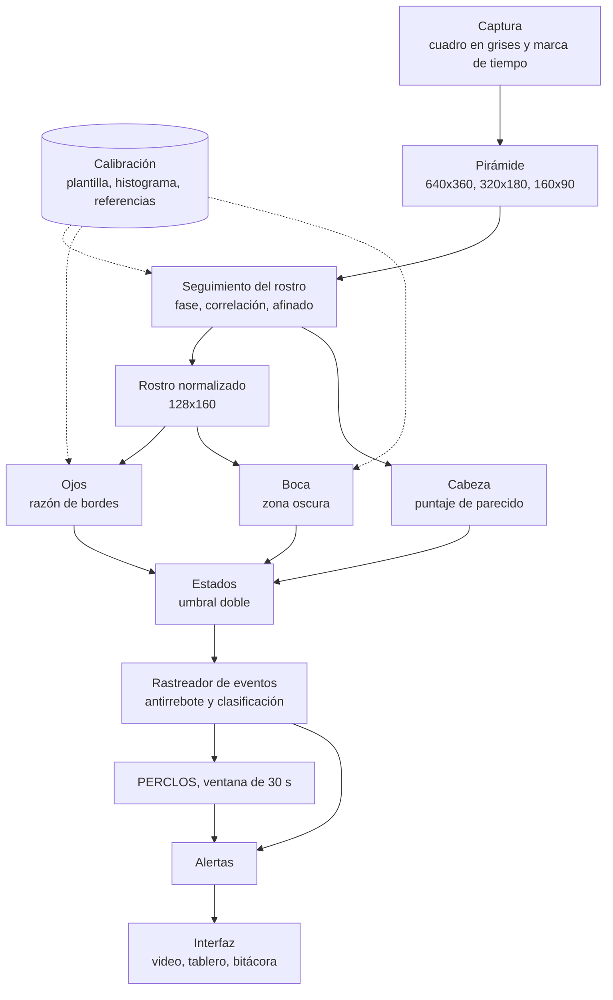

# Arquitectura

Este documento describe el sistema tal como está escrito hoy. El detalle de cada archivo está en el README de su carpeta.

## Idea general

El sistema tiene dos capas que no se mezclan.

La capa de **percepción** recibe un cuadro de video y entrega tres mediciones entre 0 y 1: qué tan abiertos están los ojos, qué tan abierta está la boca y qué tan de frente está la cabeza. Aquí viven todos los algoritmos de visión computacional.

La capa **temporal** no ve imágenes. Recibe esas tres mediciones con su marca de tiempo y decide qué está pasando: si hubo un parpadeo y de qué tipo, si hay un bostezo, cuánto lleva la persona sin mirar al frente, cuánto vale PERCLOS y qué alerta toca.

Separarlas tiene tres ventajas prácticas:

- La capa temporal se prueba con señales inventadas, sin imágenes.
- Cuando algo falla, se sabe de qué lado está el problema. Si la medición de ojos es correcta y el parpadeo sale mal clasificado, el error está en la capa temporal.
- Las reglas del enunciado (0.5 s, 7 s, PERCLOS de 30 s) quedan en un solo lugar, fáciles de leer y de defender.

## Diagrama



De `Captura` a `Cabeza` es percepción. De `Estados` a `Alertas` es la capa temporal.

## Quién llama a quién

```
principal.py                      programa: argumentos, ventanas, teclas
 ├── percepcion/captura.py        Captura.leer() -> (gris, t)
 ├── sistema.py                   Sistema.iniciar(), procesar(), terminar()
 │    ├── percepcion/piramide.py
 │    ├── percepcion/rostro.py         usa correlacion.py y piramide.py
 │    ├── percepcion/geometria.py
 │    ├── percepcion/ojos.py           usa gradiente.py y preproceso.py
 │    ├── percepcion/preproceso.py     tabla de especificación de histograma
 │    ├── percepcion/boca.py
 │    ├── percepcion/cabeza.py
 │    └── temporal/capa.py             CapaTemporal.actualizar()
 │         ├── temporal/estados.py
 │         ├── temporal/eventos.py
 │         ├── temporal/perclos.py
 │         └── temporal/alertas.py
 ├── interfaz/overlay.py          dibujar(), vista_de_depuracion()
 ├── interfaz/controles.py        deslizadores
 └── interfaz/bitacora.py         eventos a CSV
```

`Sistema` no sabe de cámaras ni de ventanas. Recibe un cuadro y entrega un diccionario `resumen`. Por eso el mismo código sirve para la cámara, para un video, para la evaluación y para las pruebas.

## Recorrido de un cuadro

Lo que le pasa a un cuadro durante la vigilancia. Los números son de ejemplo.

1. **Captura.** Llega un cuadro de 1280×720 con marca de tiempo `t = 12.40 s`. Se pasa a grises y se reduce a la mitad, 640×360, que es el tamaño de trabajo.
2. **Pirámide.** Se construyen tres niveles: 640×360, 320×180 y 160×90.
3. **Predicción.** En el nivel de 160×90 se compara la zona del rostro del cuadro anterior con la misma zona del actual, usando correlación de fase. Dice que el contenido se movió 1 px a la derecha. La búsqueda se centra ahí.
4. **Búsqueda gruesa.** En la banda laplaciana del nivel de 160×90 se busca la plantilla del rostro en una ventana de 17×17 posiciones, con correlación normalizada. El mejor lugar tiene un puntaje de 0.82.
5. **Afinado.** La posición se afina en el nivel de 320×180, en una ventana de 5×5 posiciones. Sale la caja del rostro en el cuadro completo.
6. **Cabeza.** La frontalidad es el puntaje, 0.82. Está arriba del umbral de distracción (0.50), así que el rostro está de frente y se miden ojos y boca.
7. **Normalización.** La caja se lleva a 128×160 con mapeo inverso. Los ojos y la boca caen siempre en las mismas filas.
8. **Ojos.** Se recorta cada ojo (64 px de ancho), se descarta la parte de la ceja, se suaviza y se calcula la razón entre bordes verticales y horizontales alrededor de la banda más oscura. El promedio de los dos ojos da 0.67. En la calibración esa razón fue 0.74 con los ojos abiertos y 0.39 con los ojos cerrados, así que la apertura vale (0.67 − 0.39) / (0.74 − 0.39) = 0.80.
9. **Boca.** Se arma la tabla de especificación de histograma con la parte de arriba del rostro y se aplica al rostro completo. En la franja de la boca se mide el alto de la zona oscura. Menos su valor en reposo da 0.02.
10. **Estados.** Ojos `ABIERTO`, boca `CERRADA`, cabeza `ATENTO`.
11. **Eventos y PERCLOS.** No hay ningún evento abierto. En los últimos 30 s hubo 1.2 s de cierres largos, PERCLOS = 4.0%, nivel normal.
12. **Alerta.** Ninguna.
13. **Interfaz.** Se dibuja la caja en verde, las tres barras, PERCLOS y los contadores.

Si en el paso 4 el puntaje hubiera sido 0.30, el rostro no estaría de frente. La caja se queda donde estaba, los ojos y la boca se reportan con `valido = False` (no se inventa una medición sobre una cara que no se ve) y la cabeza pasa a `DISTRAIDO`. Cada 5 cuadros se busca el rostro en toda la imagen pequeña.

## Contratos entre módulos

Un contrato es el acuerdo sobre qué entrega cada módulo. Mientras se respete, cada quien puede cambiar su parte sin romper las demás.

### De la percepción a la capa temporal: `Medicion`

```python
@dataclass
class Medicion:
    t: float        # marca de tiempo en segundos
    valor: float    # entre 0 y 1
    valido: bool    # False si no se pudo medir en este cuadro
```

| Medición | `valor = 1` | `valor = 0` | ¿Puede ser no válida? |
|---|---|---|---|
| Ojos | Tan abiertos como en la calibración | Tan cerrados como en la calibración | Sí, si el rostro no está de frente |
| Boca | Zona oscura tan alta como el rostro (no se alcanza) | Como en reposo | Sí, si el rostro no está de frente |
| Cabeza | Idéntica a la plantilla de frente | Sin parecido | No |

### De la capa temporal hacia afuera: `Evento`

```python
@dataclass
class Evento:
    tipo: str         # "parpadeo", "bostezo" o "distraccion"
    inicio: float
    fin: float
    duracion: float
    categoria: str    # "normal", "lento", "microsueno", "bostezo" o la banda
```

### Del sistema a la interfaz: el diccionario `resumen`

Lo entrega `Sistema.procesar`. Sus claves están en `somnolencia/README.md`.

## Calibración

La hace `Sistema`, en dos momentos.

**Al iniciar** (`Sistema.iniciar`, con la caja del rostro):

- Se guardan las plantillas del rostro para el seguimiento.
- Se guarda el histograma acumulado de la parte de arriba del rostro.
- Se calcula el umbral de gris de la boca y su medida en reposo.

**Durante los 5 s siguientes** (fase `calibrando`):

| Paso | Duración | La persona | Se reúne |
|---|---|---|---|
| 1 | 3 s | Mira al frente con los ojos abiertos y la boca cerrada | Razón de ojos abiertos y medida de la boca en reposo |
| 2 | 2 s | Cierra los ojos | Razón de ojos cerrados |

De cada paso se descarta el primer medio segundo y se toma la mediana de lo demás. Con la mediana, un parpadeo durante el paso 1 no arruina la referencia.

Con eso todos los umbrales son relativos a la persona y a la luz del momento. La limitación es que el sistema queda calibrado para una persona por sesión.

Si la calibración de ojos no es confiable (pocos cuadros útiles, o abiertos y cerrados dan casi lo mismo), se usan las referencias generales de `config.py`, que salieron del dataset de Kaggle, y se muestra un aviso.

Con `--sin-calibracion` se salta la segunda parte y se vigila desde el primer cuadro.

La calibración vive solo en memoria. Contiene una imagen del rostro, así que no se guarda.

## Cómo se obtiene la caja del rostro en el primer cuadro

El sistema no detecta rostros. Necesita que alguien le diga dónde está la cara al empezar.

| Situación | De dónde sale la caja |
|---|---|
| Cámara | La persona pone la cara en un recuadro central y pulsa la barra espaciadora |
| Archivo de video, con ventana | Quien opera marca el rostro con el ratón |
| Archivo de video, sin ventana | Se pasa con `--caja x,y,ancho,alto` |
| Escena dibujada | La conoce el programa |

## Tiempo por cuadro

A 15 cuadros por segundo hay 66 ms por cuadro. Con la escena dibujada, el proceso completo de un cuadro tarda entre 8 y 11 ms según la computadora. Eso no incluye leer el cuadro, reducirlo de 1280×720 ni dibujar.

Tiempo de cada algoritmo por separado, medido con `python -m verificacion.verificar` en dos computadoras:

| Algoritmo | Tamaño | Computadora A | Computadora B |
|---|---|---|---|
| Suavizado binomial | 640×360 | 1.6 ms | 3.4 a 5.0 ms |
| Pirámide de 3 niveles | 640×360 | 2.1 ms | 4.3 a 5.1 ms |
| Correlación normalizada | 17×17 posiciones | 2.7 ms | 4.1 a 5.1 ms |
| Correlación de fase | 128×160 | 1.2 ms | 1.8 ms |
| Mapeo inverso | a 128×160 | 0.3 ms | 0.6 ms |
| Especificación de histograma | 128×160 | 0.3 ms | 0.2 a 0.7 ms |

El cuadro más lento es el de búsqueda completa cuando el rostro se perdió: cerca de 100 ms, una vez cada 5 cuadros mientras siga perdido.

El desglose por etapa dentro del sistema todavía no existe. Es la tarea T10.

## Lo que queda fuera del sistema

Estas carpetas ayudan a construir y a evaluar, pero no se ejecutan durante la demo:

- `verificacion/` compara cada algoritmo propio contra OpenCV.
- `evaluacion/` calcula métricas sobre datasets y videos anotados.
- `pruebas/` contiene las pruebas automáticas.
