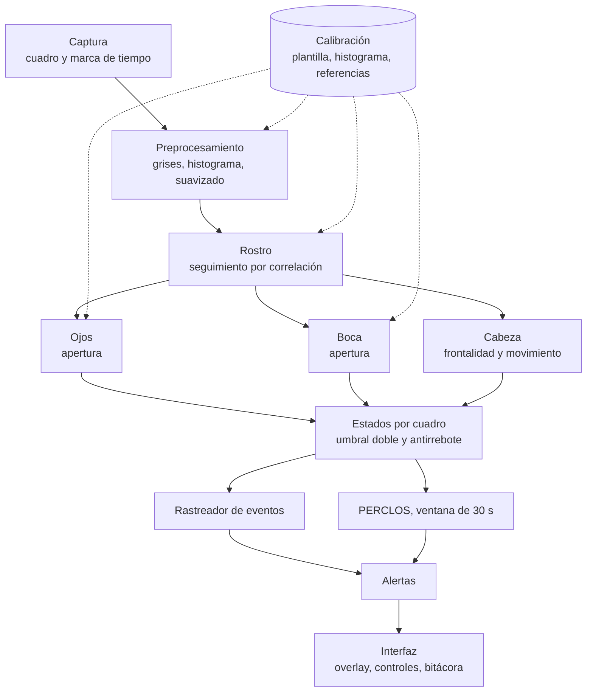

# Arquitectura

## Idea general

El sistema tiene dos capas que no se mezclan.

La capa de **percepción** recibe un cuadro de video y entrega tres mediciones: qué tan abiertos están los ojos, qué tan abierta está la boca y qué tan de frente está la cabeza. Aquí viven todos los algoritmos de visión computacional.

La capa **temporal** no ve imágenes. Recibe esas tres mediciones con su marca de tiempo y decide qué está pasando: si hubo un parpadeo y de qué tipo, si hay un bostezo, cuánto lleva la persona sin mirar al frente, cuánto vale PERCLOS y qué alerta toca.

Separarlas tiene tres ventajas prácticas:

- La capa temporal se puede programar y probar desde el primer día con señales inventadas, sin esperar a que la percepción funcione.
- Cuando algo falla, se sabe de qué lado está el problema. Si la medición de ojos es correcta y el parpadeo sale mal clasificado, el error está en la capa temporal.
- Las reglas del enunciado (0.5 s, 7 s, PERCLOS de 30 s) quedan en un solo lugar, fáciles de leer y de defender.

## Diagrama



De `Captura` a `Cabeza` es percepción. De `Estados por cuadro` a `Alertas` es la capa temporal.

## Recorrido de un cuadro

Para aterrizarlo, esto es lo que le pasa a un solo cuadro. Los números son de ejemplo.

1. **Captura.** Llega un cuadro con marca de tiempo `t = 12.40 s`. Si mide 1280×720 se reduce a la mitad, 640×360, que es el tamaño de trabajo.
2. **Preprocesamiento.** Se pasa a grises y se construye una pirámide gaussiana de tres niveles (640×360, 320×180, 160×90).
3. **Rostro.** En el nivel de 160×90 se busca la plantilla frontal guardada en la calibración, solo alrededor de donde estaba el rostro en el cuadro anterior. La mejor coincidencia se afina en 320×180. Resultado: caja del rostro y un puntaje de correlación de 0.82.
4. **Normalización.** La caja se lleva a un tamaño fijo de 128×160 con mapeo inverso, y su histograma se ajusta al del cuadro de calibración. A partir de aquí los ojos y la boca caen siempre en las mismas filas.
5. **Ojos.** En la franja de los ojos se calcula el gradiente vertical y se suma por renglón. Aparecen dos picos separados 9 px. En la calibración la separación fue de 11 px con los ojos abiertos y de 1 px con los ojos cerrados, así que la apertura vale (9 − 1) / (11 − 1) = 0.80.
6. **Boca.** La misma medida en la franja de la boca da 0.03. Está cerrada.
7. **Cabeza.** La frontalidad es el puntaje de correlación, 0.82. La correlación de fase contra el cuadro anterior dice que la cabeza se movió 1 px a la derecha.
8. **Estados.** Ojos `ABIERTO` (0.80 está por encima del umbral de reapertura), boca `CERRADA`, cabeza `ATENTO`.
9. **Eventos y PERCLOS.** No hay ningún evento abierto. En los últimos 30 s hubo 1.2 s de cierres largos, PERCLOS = 4.0%, nivel normal.
10. **Interfaz.** Se dibuja la caja, las tres mediciones, PERCLOS y los contadores. No hay alerta.

Si en el paso 3 el puntaje hubiera caído a 0.30, el rostro ya no estaría de frente. En ese caso los ojos y la boca se reportan como `SIN_DATO` (no se inventa una medición sobre una cara que no se ve bien) y la cabeza pasa a `DISTRAIDO`.

## Contratos entre módulos

Un contrato es el acuerdo sobre qué entrega cada módulo. Si todos lo respetan, cada quien puede trabajar por separado y las piezas embonan al juntarlas. Estas estructuras van en `somnolencia/tipos.py`.

```python
@dataclass
class Medicion:
    t: float        # marca de tiempo en segundos
    valor: float    # entre 0 y 1
    valido: bool    # False si no se pudo medir en este cuadro

@dataclass
class Evento:
    tipo: str         # "parpadeo", "bostezo" o "distraccion"
    inicio: float     # segundos
    fin: float        # segundos
    duracion: float   # fin - inicio
    categoria: str    # "normal", "lento", "microsueno", o la banda de distracción
```

Significado de `valor` en cada medición:

| Medición | `valor = 1` | `valor = 0` |
|---|---|---|
| Ojos | Tan abiertos como en la calibración | Tan cerrados como en la calibración |
| Boca | Apertura igual al alto del rostro (nunca se alcanza) | Cerrada |
| Cabeza | Idéntica a la plantilla frontal | Sin parecido con la plantilla |

## Módulos

| Archivo | Qué hace | Recibe | Entrega | Frente |
|---|---|---|---|---|
| `percepcion/captura.py` | Abre cámara o video y entrega cuadros con tiempo | Fuente | Cuadro, `t` | 1 |
| `percepcion/calibracion.py` | Aprende plantilla, histograma y referencias de la persona | Cuadros iniciales | `Calibracion` | 1 |
| `percepcion/piramide.py` | Pirámide gaussiana y banda laplaciana | Imagen | Niveles | 1 |
| `percepcion/correlacion.py` | Correlación normalizada y correlación de fase | Dos imágenes | Mapa o desplazamiento | 1 y 3 |
| `percepcion/geometria.py` | Recorte y escalado con mapeo inverso | Imagen, caja | Rostro normalizado | 1 |
| `percepcion/rostro.py` | Sigue el rostro de un cuadro al siguiente | Imagen, calibración | Caja, puntaje | 1 |
| `percepcion/preproceso.py` | Grises, suavizado binomial, especificación de histograma | Imagen | Imagen | 2 |
| `percepcion/gradiente.py` | Gradiente vertical, perfil por renglón, separación de picos | Franja | Separación en px | 2 |
| `percepcion/ojos.py` | Mide apertura de ojos | Rostro normalizado | `Medicion` | 2 |
| `percepcion/boca.py` | Mide apertura de boca | Rostro normalizado | `Medicion` | 3 |
| `percepcion/cabeza.py` | Mide frontalidad y movimiento | Puntaje, cuadros | `Medicion` | 3 |
| `temporal/estados.py` | Convierte mediciones en estados estables | `Medicion` | Estado | 4 |
| `temporal/eventos.py` | Abre, cierra y clasifica eventos | Estados | `Evento` | 4 |
| `temporal/perclos.py` | PERCLOS sobre 30 s | Estados de ojos | Porcentaje, nivel | 4 |
| `temporal/alertas.py` | Decide qué alerta mostrar | Eventos, PERCLOS | Alerta | 4 |
| `interfaz/overlay.py` | Dibuja sobre el video | Todo lo anterior | Cuadro anotado | 4 |
| `interfaz/controles.py` | Deslizadores para cambiar parámetros en vivo | Config | Config | 4 |
| `interfaz/bitacora.py` | Guarda eventos en CSV | `Evento` | Archivo | 4 |
| `principal.py` | Ciclo que une todo | Fuente | Ventana y bitácora | 4 |

Cada archivo está descrito con más detalle en el README de su carpeta.

## Calibración

Al iniciar, la interfaz muestra un recuadro y pide a la persona colocar ahí la cara. La calibración tiene dos pasos.

**Paso 1, ojos abiertos (3 s).** La persona mira al frente con la boca cerrada. El sistema guarda:

- La plantilla frontal del rostro, que después se busca en cada cuadro.
- El histograma de referencia, al que se ajustan los cuadros siguientes.
- La separación de párpados con los ojos abiertos.
- La apertura de la boca en reposo.

**Paso 2, ojos cerrados (2 s).** La persona cierra los ojos hasta oír un aviso. El sistema guarda:

- La separación de párpados con los ojos cerrados.
- Las filas del rostro donde el perfil de gradiente más cambió entre el paso 1 y el paso 2. Esas filas son las de los ojos. Así la franja de medición deja fuera las cejas, que también son bordes horizontales y confundirían la medida.

La consecuencia es que todos los umbrales son relativos a la persona y a la luz de ese momento. La limitación es que el sistema queda calibrado para una persona por sesión. Si cambia la persona o la luz cambia mucho, hay que recalibrar (una tecla lo hace).

La calibración vive solo en memoria mientras corre el programa. Si se guarda en disco, va a `salidas/`, que no se sube al repositorio, porque la plantilla es una imagen del rostro.

## Presupuesto de tiempo por cuadro

A 15 cuadros por segundo hay 66 ms por cuadro. Este reparto es una estimación inicial para saber dónde mirar si el sistema va lento. Los valores reales se miden con `evaluacion/desempeno.py`.

| Etapa | Presupuesto |
|---|---|
| Captura y grises | 5 ms |
| Pirámide | 5 ms |
| Seguimiento del rostro | 20 ms |
| Normalización e histograma | 8 ms |
| Ojos y boca | 8 ms |
| Cabeza (correlación de fase) | 10 ms |
| Capa temporal | menos de 1 ms |
| Interfaz | 8 ms |
| **Total** | **alrededor de 65 ms** |

La etapa más cara es el seguimiento del rostro. Se mantiene barata buscando solo cerca de la posición anterior y en el nivel más pequeño de la pirámide.

## Lo que queda fuera del sistema

Estas carpetas ayudan a construir y a evaluar, pero no se ejecutan durante la demo:

- `verificacion/` compara cada algoritmo propio contra OpenCV.
- `evaluacion/` calcula métricas sobre datasets y videos anotados.
- `pruebas/` contiene las pruebas automáticas.
